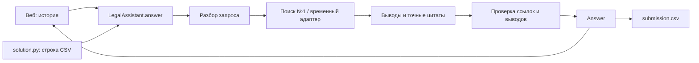

# Юридический ассистент ПСБ — движок участника №2

Общий Python-движок для веб-чата и конкурсного `solution.py`: ответ по базе документов, история, точные цитаты, редакции, контроль выводов и CSV. Веб, Docker и окончательная упаковка — зона участника №3, основной поиск и разрешение редакций — участника №1.

[Разбор кейса](docs/case-analysis.md) · [Контракты и подключение №1/№3](docs/contracts.md) · [Проверки и ограничения](docs/validation.md) · [План команды](PLAN.md)

## Запуск CSV

Python 3.11+. В `data/` положите полученные у организаторов `questions.csv` и `knowledge-base.zip`. Установите зависимости:

```bash
python3 -m venv .venv
.venv/bin/python -m pip install -r requirements.txt
```

Заполните окружение значениями организаторов; `.env.example` содержит список. Скрипт **не загружает .env автоматически**. Значения можно передать окружением контейнера или экспортировать в оболочке. Не записывайте действующие ключи в репозиторий.

```bash
DATA_DIR=data .venv/bin/python solution.py
```

Результат — `submission.csv` в текущем рабочем каталоге: UTF-8, `id,answer`, все ID без повторов, непустые ответы до 10 000 символов. В ответах включены названия, пункты, редакции и цитаты. Технические ошибки также дают строку на каждый ID; сводка статусов печатается отдельно. Наличие файла с error-ответами не подтверждает качество решения.

Без `SEARCH_FACTORY` используется временный лексический поиск по настоящему ZIP. Он не читает demo_output и не подставляет ответы по ID. Индекс №1 подключается через `SEARCH_FACTORY=retrieval:create_search`.

## Веб и Python

```python
from assistant import answer

result = await answer([{"role": "user", "content": "Какой срок оплаты по договору?"}])
print(result.model_dump(mode="json"))
```

Для FastAPI создайте `LegalAssistant(search, client)` один раз в lifespan, передавайте историю конкретного диалога и закрывайте клиент при остановке. Полный пример — в [контракте](docs/contracts.md).



## Окружение

| Переменные | Назначение |
|---|---|
| LLM_BASE_URL / OPENAI_BASE_URL | Адрес общего прокси; суффикс `/v1`, если нужен, уже входит в выданный адрес. |
| LLM_API_KEY / OPENAI_API_KEY | Общий ключ прокси, без записи в код/логи. |
| LLM_MODEL / OPENAI_MODEL / GEN_MODEL | ID генерации, по приоритету слева направо. На платформе DeepSeek V4.1 Flash. |
| EMB_MODEL | Выданный ID bge-m3; требуется для вызова embeddings. |
| RERANKER_MODEL | Выданный ID Qwen3 Reranker 8B; без него резервный поиск не вызывает rerank. |
| DATA_DIR | Каталог входа, по умолчанию `data`. |
| TEMPERATURE, MAX_TOKENS | 0 и 2500 по умолчанию. |
| MAX_WORKERS | Общий предел параллельных API-запросов и CSV-воркеров, 2 по умолчанию, максимум 8. |
| API_TIMEOUT, API_RETRIES | Тайм-аут HTTP 60 секунд, максимум 2 повтора после первой попытки; только временные ошибки. |
| QUESTION_TIMEOUT, RUN_TIMEOUT | До 240 секунд на вопрос; 1120 секунд на обработку строк с резервом перед 20-минутным лимитом. |
| TOP_K, RERANKER_TOP_N | 12 кандидатов и до 8 результатов реранкера. |
| VERIFY_ANSWER | 1 — отдельная модельная проверка, 0 — базовый вариант. |
| SEARCH_FACTORY | `корневой_модуль:фабрика` индекса №1. |
| CHUNKER | Настройка платформы для поиска №1; временный адаптер использует собственное разбиение. |

Модели не угадываются по названиям из кейса. Специальный JSON-mode не используется без проверки поддержки. Сбои API, неверный ответ прокси и сбои индекса возвращаются как `error`, отдельно от `insufficient`.

## Проверки

```bash
.venv/bin/python -m pip install -r requirements-dev.txt
.venv/bin/python -m pytest -q
```

Проверки используют заглушки моделей и локальный HTTP-сервер. Они не требуют ключей, внешних моделей или архива организаторов. Примеры в `examples/` — выдуманные данные для контракта; рабочий поиск их не загружает.

На конкурс переносятся корневые `schemas.py`, `llm_client.py`, `assistant.py`, `search_adapter.py`, `solution.py`, модуль поиска №1 и `requirements.txt`. Не переносите `.env`, тесты, демоответы и виртуальное окружение. Упаковку и Docker согласует №3; документация не заявляет их готовыми.
