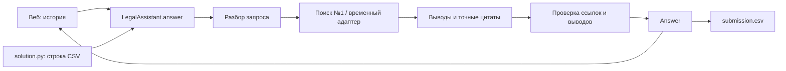

# Юридический ассистент ПСБ

Веб-чат и конкурсный `solution.py` используют один Python-движок: ответ по базе документов, история, точные цитаты, редакции и контроль выводов. Поиск №1 подключён; базовая веб-часть с Docker подготовлена для продолжения участником №3.

[Разбор кейса](docs/case-analysis.md) · [Контракты](docs/contracts.md) · [Передача №3](docs/participant3-handoff.md) · [Проверки веба](docs/web-validation.md) · [План команды](PLAN.md)

## Веб: одна команда

После клонирования положите базу организаторов в `data/knowledge-base.zip`. Для ответов заполните `.env` по `.env.example` значениями прокси; без модели доступен просмотр документов, без выдуманных ответов.

```bash
docker compose up --build
```

Откройте **http://localhost:8000**. Чат показывает основания под ответом и выделяет цитату в полном исходном тексте. Есть продолжение диалога, дата события, отдельные диалоги во вкладке и мобильный интерфейс. Остановка: `docker compose down`. Ключи не включаются в образ, база подключается read-only.

Прямой запуск после экспорта окружения:

```bash
.venv/bin/python -m pip install -r requirements-web.txt
.venv/bin/python -m uvicorn web_app:app --host 127.0.0.1 --port 8000
```

В `.env` Docker Compose читает настройки сам; при прямом запуске экспортируйте их в оболочке. Создание .venv описано ниже. Подробная инструкция, API и следующий план для №3 — в [передаче веб-части](docs/participant3-handoff.md).

## Запуск CSV

Python 3.11+. В `data/` положите полученные у организаторов `questions.csv` и `knowledge-base.zip`. Установите зависимости:

```bash
python3 -m venv .venv
.venv/bin/python -m pip install -r requirements.txt
```

Заполните окружение значениями организаторов; `.env.example` содержит список. Скрипт **не загружает .env автоматически**. Значения можно передать окружением контейнера или экспортировать в оболочке. Не записывайте действующие ключи в репозиторий.

```bash
DATA_DIR=data .venv/bin/python solution.py
```

Результат — `submission.csv` в текущем рабочем каталоге: UTF-8, `id,answer`, все ID без повторов, непустые ответы до 10 000 символов. В ответах включены названия, пункты, редакции и цитаты. Технические ошибки также дают строку на каждый ID; сводка статусов печатается отдельно. Наличие файла с error-ответами не подтверждает качество решения.

По умолчанию используется поиск участника №1: `retrieval:create_search`. Он не читает demo_output и не подставляет ответы по ID. Для явного выбора первоначального резервного поиска задайте `SEARCH_FACTORY=search_adapter:create_lexical_search`; при ошибке основного поиска автоматической подмены нет.

## Подключение поиска №1

Модуль `retrieval.py` строит индекс по базе один раз. По умолчанию поиск
совмещает BM25 с embeddings из `EMB_MODEL`; без embeddings или при их сбое
работает BM25 fallback. Подключённый `RERANKER_MODEL` применяется как
необязательный реранкер. После ошибки embeddings BM25 используется с
экспоненциальной паузой перед следующей попыткой; корпусные векторы кэшируются
вне репозитория по fingerprint базы и model ID. Синхронная фабрика возвращает
backend с асинхронным методом `search`, совместимым с `schemas.SearchResult`:

```bash
DATA_DIR=data SEARCH_FACTORY=retrieval:create_search .venv/bin/python solution.py
```

Для локальной проверки без API:

```bash
.venv/bin/python retrieval.py data/knowledge-base.zip \
  --query "срок оплаты по договору П-17/2024" --top-k 10 --stats
```

Подробности JSON-контракта, фильтров дат, координат исходных цитат и получения
документа/соседних фрагментов — в [инструкции поиска](RETRIEVAL_CONTRACT.md).

## Веб и Python

```python
from assistant import answer

result = await answer([{"role": "user", "content": "Какой срок оплаты по договору?"}])
print(result.model_dump(mode="json"))
```

Для FastAPI создайте `LegalAssistant(search, client)` один раз в lifespan, передавайте историю конкретного диалога и закрывайте клиент при остановке. Полный пример — в [контракте](docs/contracts.md).



## Окружение

| Переменные | Назначение |
|---|---|
| LLM_BASE_URL / OPENAI_BASE_URL | Адрес общего прокси; суффикс `/v1`, если нужен, уже входит в выданный адрес. |
| LLM_API_KEY / OPENAI_API_KEY | Общий ключ прокси, без записи в код/логи. |
| LLM_MODEL / OPENAI_MODEL / GEN_MODEL | ID генерации, по приоритету слева направо. На платформе DeepSeek V4.1 Flash. |
| EMB_MODEL | Выданный ID bge-m3; требуется для вызова embeddings. |
| OTOROP_EMBEDDING_CACHE_DIR | Каталог кэша корпусных embeddings: для solution.py и Docker по умолчанию `/tmp/otorop/embeddings`; при прямом вызове retrieval — `~/.cache/otorop/embeddings`. |
| RERANKER_MODEL | Выданный ID Qwen3 Reranker 8B; без него резервный поиск не вызывает rerank. |
| DATA_DIR | Каталог входа, по умолчанию `data`. |
| TEMPERATURE, MAX_TOKENS | 0 и 2500 по умолчанию. |
| MAX_WORKERS | Общий предел параллельных API-запросов и CSV-воркеров, 2 по умолчанию, максимум 8. |
| API_TIMEOUT, API_RETRIES | Тайм-аут HTTP 60 секунд, максимум 2 повтора после первой попытки; только временные ошибки. |
| QUESTION_TIMEOUT, RUN_TIMEOUT | До 240 секунд на вопрос; 1120 секунд на обработку строк с резервом перед 20-минутным лимитом. |
| SEARCH_RETRIES | Один адресный повтор поиска при нехватке подтверждений; 0 отключает. |
| TOP_K, RERANKER_TOP_N | 12 кандидатов и до 8 результатов реранкера. |
| VERIFY_ANSWER | 1 — отдельная модельная проверка, 0 — базовый вариант. |
| SEARCH_FACTORY | `корневой_модуль:фабрика`; по умолчанию `retrieval:create_search`. |
| CHUNKER | Настройка платформы для поиска №1; временный адаптер использует собственное разбиение. |
| WEB_PORT | Локальный порт Compose, по умолчанию 8000. |

Модели не угадываются по названиям из кейса. Специальный JSON-mode не используется без проверки поддержки. Сбои API, неверный ответ прокси и сбои индекса возвращаются как `error`, отдельно от `insufficient`.

## Проверки

```bash
.venv/bin/python -m pip install -r requirements-dev.txt
.venv/bin/python -m pytest -q
```

Проверки используют заглушки моделей и локальный HTTP-сервер. Они не требуют ключей или внешних моделей. Основные проверки стыковки используют выдуманный ZIP; дополнительные проверки поиска на настоящих материалах запускаются при наличии `data/knowledge-base.zip`, а без него пропускаются. Примеры в `examples/` — выдуманные данные для контракта; рабочий поиск их не загружает.

Конкурсный ZIP создаёт `.venv/bin/python tools/package_submission.py`: `dist/psb-submission.zip`. В корне находятся только `schemas.py`, `llm_client.py`, `assistant.py`, `search_adapter.py`, `solution.py`, `documents.py`, `retrieval.py`, `temporal.py`, `diagnostics.py` и `requirements.txt`. `.env`, база, тесты, демоответы, веб-зависимости и виртуальное окружение туда не попадают. Веб и Docker остаются в репозитории для финального прототипа.

Для прогона на платформе с отчётом:

```bash
.venv/bin/python tools/package_submission.py --with-report --verify-answer 1 \
  --output dist/psb-submission-report.zip
```

Во время запуска появится run-report.jsonl: ответы, источники, статусы, ошибки JSON, этапы и число реальных API-вызовов. Доступ к скачиванию дополнительных файлов нужно уточнить у организаторов. Сравнение VERIFY=0/1, локальный runner для собственного доступа и изменения достоверности описаны в [протоколе №2](docs/answer-reliability.md).

Официальный прокси выдаётся только на конкурсной платформе, отдельного локального ключа организаторы не предоставляют. Реальные вызовы DeepSeek и официальный балл ещё не проверены. Локальные API- и браузерные проверки используют заглушки; их результаты не доказывают качество модели.
